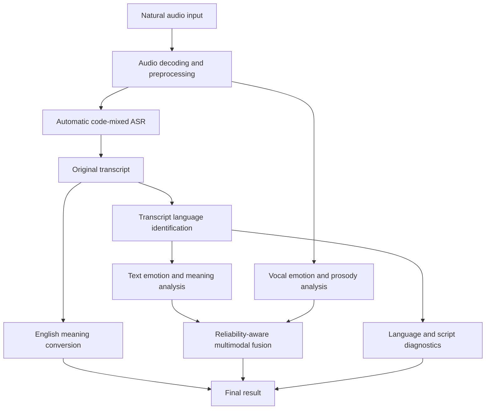

# SpeechMind — Product Specification and Architecture

Version: 2.0 proposal  
Status: implementation and evaluation in progress

## 1. Product identity

**SpeechMind is an automatic multilingual speech-understanding system for Indian speakers.**

It accepts natural speech in English, Hindi, Hinglish and supported Indian languages. The speaker must not be asked to select a language, identify their own code-switching pattern, or change how they normally speak.

**Core product principle: SpeechMind adapts to the speaker, not the speaker to SpeechMind.**

SpeechMind is not merely a speech-to-text converter. Its job is to:

1. Recognize what the speaker said, including language switches within a sentence.
2. Preserve the original transcript.
3. Convert the transcript's meaning into natural English as a separate output.
4. Analyze the semantic/emotional content of the words.
5. Analyze emotional and prosodic information in the original audio.
6. Combine the two analyses without hiding disagreement or uncertainty.
7. Present a useful interpretation of the actual recording.

It must not diagnose mental-health conditions or claim to know a person's internal state.

## 2. Fixed user experience

There is no language selector at the beginning.

The user uploads or records audio and presses Analyze. SpeechMind handles language identification automatically. It displays:
- Original transcript, preserving the language/script mixture as recognized.
- English meaning, separately from the original transcript.
- Detected language profile and, where available, segment-level language estimates.
- Textual emotion/meaning analysis.
- Vocal emotion and acoustic indicators.
- Combined interpretation, including text/voice disagreement.
- ASR quality and model/evaluation diagnostics.

The transcript must never be replaced by its translation. Romanized Hindi must not be silently treated as English.

## 3. Target language scope

The core use cases are:
- English.
- Hindi in Devanagari.
- Romanized Hindi and Hindi-English Hinglish.
- English-Hindi code-switching within one utterance.

The initial regional-language pilot is Bengali, Marathi, Tamil, Telugu and Punjabi. The architecture should not prevent additional Indian languages from being added later.

Support is component-specific. A language may be transcribed and translated before it has a validated text-emotion or voice-emotion model. The UI must disclose an unavailable branch rather than pretending it supports that language.

## 4. Architecture

### Stage A — Audio input and preparation

Decode WAV/MP3/M4A to mono float32 at 16 kHz. Retain the original recording for the voice branch. Avoid aggressive silence trimming or normalization that would remove meaningful pauses, hesitation or relative vocal intensity. Any preprocessing change must be benchmarked against the current version.

### Stage B — Automatic code-mixed ASR

The primary candidate is AI4Bharat/Bodhan Indic-Transcribe through its optional API. It is designed for Indian languages, accents and code-mixed speech. The current PC is not suitable for assuming a 1.2B-parameter model will run locally at useful speed.

When a Bodhan API key is configured, audio is sent to that service for transcription. Without a key, local Whisper Small is used as a fallback. Cloud use is explicit in the UI; recordings are not sent to Bodhan unless the user configures a key.

Do not route the entire recording to a single-language decoder based on one initial language guess. Do not ask the speaker to pick Hindi or English. ASR must transcribe the spoken mixture automatically.

The current API adapter splits long audio into overlapping sub-30-second requests and de-duplicates boundary words. This is an engineering workaround and must be validated for long recordings.

### Stage C — Transcript and language identification

The transcript is preserved independently of translation. AI4Bharat IndicLID is used downstream to estimate language/script from transcript windows, including native and Romanized Indian text. IndicLID is an estimate, not ground truth; Romanized language identification is less reliable than native-script classification.

When the IndicLID model files are absent, a script heuristic is used and is explicitly marked as a heuristic. Latin-script English and Romanized Hinglish cannot reliably be distinguished from script alone.

### Stage D — Text understanding

The first CPU-friendly Hinglish text-emotion baseline uses HinEmo-9:
- Character and word TF-IDF features.
- Linear SVM classifier.
- Human-gold training labels receive full sample weight.
- Model-derived training labels are down-weighted using the dataset's reported per-class agreement.
- Development and test splits must contain human-gold labels only.

HinEmo-9 contains nine categories: Love, Joy, Anger, Sadness, Fear, Surprise, Nostalgia, Devotion and Neutral. It is a text dataset made from YouTube comments, not a spoken-conversation corpus. Its performance must be validated on SpeechMind transcripts before deployment claims.

MuRIL or XLM-R can be evaluated later for further language coverage. They must be trained with a documented label order and language scope. An English-only model must never be applied to Hinglish or Indic text.

### Stage E — Voice understanding

The current baseline is frozen WavLM Base Plus representations with a class-balanced SVM trained on RAVDESS and CREMA-D. It predicts Joy, Sadness, Anger, Fear, Surprise, Disgust and Neutral.

Its current reported held-out macro-F1 is 65.97% on acted English speech. This is a baseline, not evidence of performance on natural Indian-language conversation.

emotion2vec is a candidate to benchmark against WavLM. Keep the voice branch independent from the transcript. Future development should separately measure vocal emotion, pitch/prosody, speaking rate and acoustic arousal rather than deriving every feature from the predicted emotion label.

### Stage F — English meaning conversion

The original transcript is translated into English separately. Bodhan Indic-Translate is the preferred code-mixed translation candidate because its API accepts text and a target language without requiring a source-language code. Local IndicTrans2 remains an offline fallback for a single known supported Indic language. Do not supply a guessed single source-language code for Hinglish.

### Stage G — Reliability-aware fusion

Text and voice branches are run independently and their outputs are preserved.

The current fusion implementation:
- Maps the nine text categories and seven voice categories into a ten-category combined space.
- Keeps Love, Nostalgia and Devotion as text-specific categories; it does not fabricate a voice prediction for them.
- Reduces text influence when ASR quality is poor or unavailable.
- Shows the individual text and voice predictions as well as the combined interpretation.
- Marks all current scores as uncalibrated.

The existing fixed text/voice weights are an initial baseline, not a final learned fusion model. Later fusion must be validated on recordings containing both human text-emotion and vocal-emotion annotations. Disagreement is meaningful and must remain visible.

## 5. Current implementation map

| Concern | Current implementation |
|---|---|
| UI | `app.py` |
| Pipeline orchestration | `pipeline.py` |
| Bodhan ASR/translation HTTP adapter | `models/bodhan_client.py` |
| Local ASR fallback | `models/asr.py` |
| Transcript LID | `models/indic_language_id.py` |
| Hinglish text emotion | `models/text_emotion.py` |
| Text model training | `scripts/train_hinemo9_text_emotion.py` |
| Voice emotion | `models/voice_emotion.py` |
| Shared WavLM features | `models/voice_features.py` |
| English meaning translation | `models/translation.py` |
| Fusion | `fusion_layer.py` |
| ASR benchmarking | `scripts/benchmark_asr.py` |

## 6. Model and data decisions

Model selection is empirical. Indic-Transcribe, Whisper and other eligible recognizers must be compared on the same human-transcribed Hinglish/Hindi/English recordings using WER and CER. Do not choose a model based only on a vendor benchmark.

Text emotion is evaluated on held-out human annotations, with per-language macro-F1 and per-class precision/recall. Voice emotion is evaluated on speaker-disjoint test speakers. Fusion requires its own joint annotated evaluation set.

Do not use RAVDESS/CREMA-D acted vocal emotion labels as text-emotion ground truth. Do not use synthetic speech as the sole real-world test set.

## 7. Privacy and operating modes

- Local mode: local Whisper and local checkpoints; no audio is sent to Bodhan.
- Cloud mode: only enabled when `BODHAN_API_KEY` is present in the local ignored `.env` file. Audio is sent to Bodhan for ASR; the transcript is sent for English translation. The app must disclose this before use.
- API costs and provider data-handling terms must be considered before sending private recordings.
- Never commit `.env`, API keys, local checkpoints, downloaded datasets or private audio.

## 8. Current limitations

- The hosted code-mixed ASR/translation path requires a Bodhan API key and has not yet been tested against SpeechMind's human-transcribed benchmark.
- Without the key, local Whisper is only a fallback and is not a code-switch-specialized solution.
- HinEmo-9 is text from YouTube comments; it is not speech transcripts and does not prove spoken-text emotion accuracy.
- The existing voice model is trained on acted English recordings; Indian-language voice emotion is not validated.
- The English-meaning offline fallback cannot reliably translate mixed-script Hinglish when no cloud translator is configured.
- Romanized IndicLID output is less reliable than native-script identification.
- The current text/voice fusion scores and branch weights are not calibrated.

## 9. Release acceptance criteria

A component is not described as supported until it has:
1. A named dataset/test protocol and license review.
2. Speaker/source-disjoint or otherwise leakage-controlled evaluation.
3. Per-language and per-class metrics.
4. Failure examples and known limitations.
5. Reproducible setup/training/evaluation scripts.
6. A tested inference path with useful diagnostics.

SpeechMind's product objective and user experience are stable. Model selection and implementation can evolve only when the evidence justifies a change; changes to the product objective require explicit discussion first.
